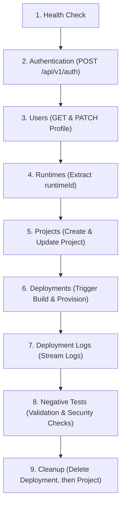

# Relay Backend API — Postman Testing Guide

This guide explains how to import, configure, and execute the automated test suite for the Relay backend using Postman or Newman.

---

## 1. Files in This Test Suite

- [`Relay.postman_collection.json`](file:///home/shivam/Desktop/Projects/Agile/Relay.postman_collection.json): The Postman Collection (v2.1) containing 43 automated requests organized into 8 functional folders.
- [`Relay Local.postman_environment.json`](file:///home/shivam/Desktop/Projects/Agile/Relay%20Local.postman_environment.json): Pre-configured environment variables for local testing against `http://localhost:3000`.

---

## 2. Import Instructions

1. Open **Postman** (Desktop app or Web).
2. Click **Import** (top left).
3. Drag and drop both `Relay.postman_collection.json` and `Relay Local.postman_environment.json`.
4. In the top-right environment dropdown, select **Relay Local**.

---

## 3. Environment Variables Reference

| Variable | Default Value | Description |
| :--- | :--- | :--- |
| `baseUrl` | `http://localhost:3000` | The backend base URL (local dev server or Vercel preview deployment). |
| `apiKey` | `very_secret_key` | Secret key validated by the `verifyApiKey` middleware via `x-api-key`. |
| `firebaseIdToken` | `""` | A valid, unexpired Firebase ID Bearer token for an authenticated user. |
| `githubToken` | `""` | GitHub Personal Access Token (for private repository access). |
| `runtimeId` | `1` | ID of a supported runtime (e.g. Node.js or Python). Auto-populated by `4.1 List Supported Runtimes`. |
| `projectId` | `""` | ID of the test project. Auto-populated by `5.1 Create Project`. |
| `deploymentId` | `""` | ID of the deployment. Auto-populated by `6.1 Create Deployment`. |
| `buildNumber` | `""` | Jenkins build number. Auto-populated when Jenkins assigns a build. |
| `startOffset` | `0` | Log byte offset for progressive log testing. |
| `testProjectName`| `""` | Auto-generated timestamped name for test isolation. |

---

## 4. How to Obtain and Supply a Firebase ID Token

Protected endpoints under `/api/v1` require `Authorization: Bearer <token>` containing verified claims (`uid`, `email`, and `name`).

### Option A: Firebase Auth REST API (Recommended for CLI / Scripting)
If your Firebase project has Email/Password authentication enabled:
```bash
curl -X POST "https://identitytoolkit.googleapis.com/v1/accounts:signInWithPassword?key=<FIREBASE_WEB_API_KEY>" \
  -H "Content-Type: application/json" \
  -d '{
    "email": "testuser@example.com",
    "password": "Password123!",
    "returnSecureToken": true
  }'
```
Copy the returned `idToken` value and paste it into the `firebaseIdToken` field in your Postman environment.

### Option B: Frontend Browser Client
If running the Relay frontend:
1. Log in via Google or Email in the application.
2. Open Browser DevTools (`F12`) > **Console**.
3. Run:
   ```javascript
   await firebase.auth().currentUser.getIdToken();
   ```
4. Copy the token string and paste it into `firebaseIdToken` in Postman.

> [!NOTE]
> Firebase ID tokens expire after 1 hour. If you receive a `401 Unauthorized ("Token expired. Please log in again.")`, refresh your token and update the `firebaseIdToken` environment variable.

---

## 5. GitHub Token Handling & Implementation Note

> [!IMPORTANT]
> **Implementation Note on GitHub Tokens**:
> In the Relay backend implementation:
> - `createDeploymentBodySchema` enforces `.strict()`, accepting **only** `{ "replicas": number }`. Passing `githubToken` in the JSON request body is actively rejected with `400 { message: "Invalid deployment request." }`.
> - The backend securely injects the GitHub token into the Jenkins build parameter `GITHUB_TOKEN` from `process.env.GITHUB_TOKEN` on the server.
>
> In this test suite:
> - Normal deployment creation requests omit `githubToken` from the body per the backend contract.
> - Request **`8.14 Create Deployment With githubToken in Body`** deliberately verifies this strict schema rejection behavior.

---

## 6. Categorization: Safe vs. Integration Tests

The collection is divided into two operational categories:

### A. Basic API Tests (Safe to run anytime)
- **Folder 1 (Health Check)**: Tests `/health` and `/secured/user`.
- **Folder 2 (Authentication)**: Tests profile initialization `/api/v1/auth`.
- **Folder 3 (Users)**: Tests profile reads and non-destructive updates.
- **Folder 4 (Runtimes)**: Read-only queries for supported Docker runtimes.
- **Folder 5 (Projects)**: Creates, reads, and updates test-owned project records in PostgreSQL.
- **Folder 8 (Negative Tests)**: Verifies input validation, unauthorized access, missing keys, and 404/409 error responses without mutating production data.

### B. Integration Tests (Require external infrastructure)
- **Folder 6 (Deployments)**:
  - `6.1` dispatches a build trigger to Jenkins (`POST /job/relay-builder/buildWithParameters`).
  - `6.3` polls status and provisions Kubernetes Deployments, Services, and Ingresses.
  - `6.5` calls `kubernetesService.deleteApp()` to tear down Kubernetes cluster resources.
- **Folder 7 (Deployment Logs)**: Streams progressive logs from Jenkins.

---

## 7. Recommended Execution Order

To run the complete collection sequentially:



### Step-by-Step Walkthrough

1. **Run `1. Health Check`**: Verifies the server is online and API key verification functions.
2. **Run `2. Authentication`**: Initializes your Relay user profile in PostgreSQL using your Firebase ID token.
3. **Run `3. Users`**: Verifies profile inspection and display name updates. *(Skip `3.4 Delete Profile` during regular runs).*
4. **Run `4. Runtimes`**: Loads supported runtimes and automatically saves `runtimeId` into the environment.
5. **Run `5. Projects` (Requests 5.1–5.4)**: Creates a new timestamped test project and saves `projectId`. *(Skip `5.5 Delete Project` until after deployments are tested).*
6. **Run `6. Deployments` & `7. Deployment Logs`**:
   - `6.1` creates a deployment and saves `deploymentId`.
   - `6.3` polls the deployment until it reaches a terminal status (`DEPLOYED` or `FAILED`).
   - `7.1` streams logs if Jenkins has started the build.
7. **Run `8. Negative Tests`**: Verifies 17 boundary conditions, invalid IDs, missing tokens, and strict schema rejections.
8. **Cleanup**:
   - Run `6.5 Delete Deployment` to clean up Kubernetes resources and mark the deployment `DELETED`.
   - Run `5.5 Delete Project` to delete the test project (only succeeds if no deployment history exists, or returns 409 if deployment history is retained).

---

## 8. External Service Prerequisites for Integration Tests

| Service | Prerequisite Check |
| :--- | :--- |
| **PostgreSQL** | Database must be migrated with Prisma (`contract.prisma`) and runtimes seeded. |
| **Jenkins** | Accessible at `JENKINS_URL` with job `relay-builder` configured with parameters: `REPO_URL`, `BRANCH`, `GITHUB_TOKEN`, `DOCKERFILE_CONTENT`, `IMAGE_NAME`, `IMAGE_TAG`. |
| **Docker Hub** | `DOCKER_USERNAME` set in backend environment; credentials configured in Jenkins. |
| **Kubernetes** | Local cluster (e.g. Kind or Minikube) accessible via `~/.kube/config`. |

---

## 9. Running with Newman (CLI)

You can run the entire safe test suite in CI/CD using **Newman**:

```bash
npm install -g newman

newman run Relay.postman_collection.json \
  -e "Relay Local.postman_environment.json" \
  --env-var "apiKey=very_secret_key" \
  --env-var "firebaseIdToken=<YOUR_FIREBASE_ID_TOKEN>" \
  --folder "1. Health Check" \
  --folder "2. Authentication" \
  --folder "3. Users" \
  --folder "4. Runtimes" \
  --folder "5. Projects" \
  --folder "8. Negative Tests"
```
